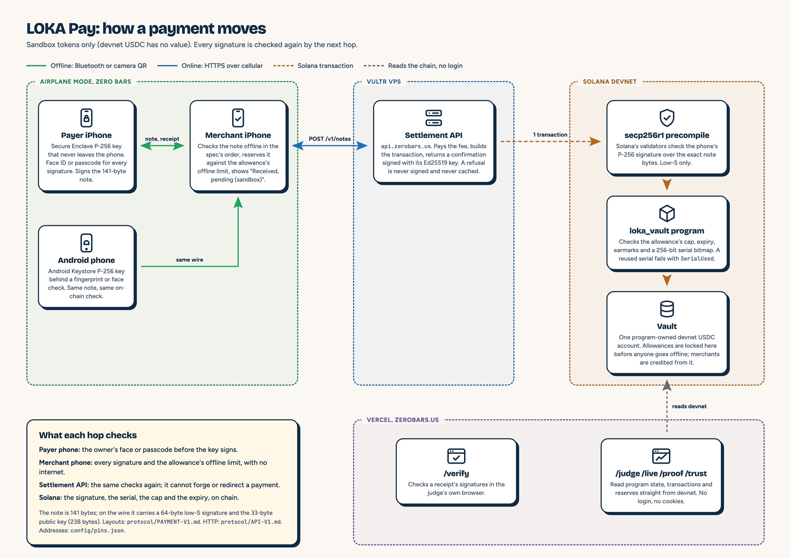

# LOKA Pay

**A phone in airplane mode pays a shop's phone directly, in one hop over Bluetooth or a QR code. The shop's phone settles the payment on Solana devnet, Solana's public test network, when it finds signal.**

Sandbox tokens only: devnet USDC has no value. Moving real dollars would require a licensed partner. We do not have one yet.

<!-- TODO(4.3): final first screen. Every number on this page comes from docs/FACTS.json. Delete each TODO line once its link answers. -->

## Try it (no login anywhere)

| What | Where | Status |
|---|---|---|
| Judge guide: a 3-minute itinerary | https://zerobars.us/judge | Live: program facts read from devnet and CI results read from GitHub when the page loads, each with its read time |
| Live ledger with explorer links | https://zerobars.us/live | Live: your browser streams the program's transactions from devnet; the chip says Live only while the connection carries traffic |
| Verify a signed receipt | https://zerobars.us/verify | Live: your browser checks every signature; try the labelled test receipt |
| Proof page: claims table, reserves, built this weekend | https://zerobars.us/proof | Live: each claim says Live only from a current read and shows its age; proof of reserves reads every balance at one slot; the commit count since hacking started comes from GitHub |
| Settlement API health check | https://api.zerobars.us/api/health | Live on devnet: `curl -s https://api.zerobars.us/api/health` returns the server's commit, the cluster, the program id and a slot it reads from devnet on each call. /proof reads it and says Live only from a current read |
| iPhone app (TestFlight) | No public link yet: it appears here once Apple approves external testing | Build 3 is installed by the team through TestFlight internal testing. Apple's external beta review (build 1 submitted Sat Oct 10, 12:05 AM ET) is still pending |
| The Solana program (devnet) | https://explorer.solana.com/address/HSgcxix3LGjdCQ7FGexBosdvzmHz7ZfHdkpyXYYteBGG?cluster=devnet | Live: deployed Sat Oct 10, 1:01 AM ET; vault initialized 1:03 AM ([transaction](https://explorer.solana.com/tx/2y4go46y25K6yMnSc4eVZCtbs3nKQzubb6Qr2Byp6piXGuCMWniaiL2aVBsrfMkAxUfJ9odVNcKKpqG3g4EraT4R?cluster=devnet)); every public address is in `config/pins.json` |
| First payment signed on an iPhone, and its refused cheat | [settled iPhone payment](https://explorer.solana.com/tx/2SpG1YURVivMHY3VNWwRsDfo7SZBjWZHXZHeqAovEh6RTNE4XVVNrH5BzU84yJk6nXyqprdHAxt22QSuktskez17?cluster=devnet) and [refused iPhone cheat](https://explorer.solana.com/tx/3XtQtnHRKC3QvhBGye8gTMWimPg3iPXuBskf3LMsQEhJPdzeGiqEEjrmjFLqXFTJMQ9JFAitWoCbuEGFSLKjZc9n?cluster=devnet) | Sat Oct 10, 4:23 PM ET: a teammate's iPhone signed the note with its Secure Enclave key and passed it by camera QR to the merchant iPhone while both phones were offline; the merchant phone settled it on devnet when it came online. At 4:31 PM ET the same allowance and serial, signed again on that iPhone for a different merchant phone, was refused on chain with `SerialUsed` (error 6011) |
| First real payment and refused cheat on devnet | [settled payment](https://explorer.solana.com/tx/5tEKu2mtrdzu9hVaXCmkGyq9Y6mTobNVBmVx5ji59hku2bf28E3okmJatw7WbPRqfHHpLf9wyC1SbjwU3PWD5rAa?cluster=devnet) and [refused cheat](https://explorer.solana.com/tx/2SQ8aiTmRizKpy17cQxzH1Bnae828qdico7Y8BMzrkYKBa1yTiBevM94ijzhEaiGZEmviaeu3BEXsRywS4Excohv?cluster=devnet) | Sat Oct 10, 2:01 AM ET: a P-256 signed note verified by Solana's secp256r1 precompile on devnet and credited the merchant; the same allowance and serial signed again was refused on chain with `SerialUsed` (error 6011). This run was signed outside the iPhone app with a test key; the run signed on an iPhone is the row above |
| Demo video (2 to 3 minutes, public) | TODO(3.7): YouTube link | TODO |

<!-- TODO(2.10): when GET /api/stats is live, add: "Check the headline numbers yourself; this endpoint recomputes them on every request", the curl, one real response, and each field named. It answers 404 today, so it stays off this page until then. -->

## What happens in the demo

1. A judge picks an amount and pays with both phones in airplane mode. The payer confirms with Face ID: the key only signs for its owner.
2. The merchant phone shows "Received, pending (sandbox)" with no internet, then turns cellular on and settles. "Paid (sandbox)" appears with a Solana explorer link the judge can open.
3. The judge presses "Try to cheat": the same allowance and serial are signed again for a second merchant, and the chain refuses it ("Failed (already spent)").

<!-- TODO(4.3): add only the T2 beats that shipped (money into airplane mode, passkey payment, Android hardware key, proof of reserves). -->

## How it works

- **The allowance** is locked in an on-chain vault before anyone goes offline, so the payer can never settle more than its cap.
- **The note** is a fixed 141-byte structure signed by a P-256 key in the iPhone's Secure Enclave, behind Face ID or the device passcode. Byte layouts and validation: `protocol/PAYMENT-V1.md`; the HTTP contract: `protocol/API-V1.md`; test vectors: `protocol/vectors/payment-v1.json`.
- **Settlement:** Solana's secp256r1 precompile verifies the phone's signature on-chain, so neither a relaying phone nor our server can forge or redirect a payment. The program checks the serial, cap, expiry and earmark, then credits the merchant.
- **Offline risk is bounded and visible:** a merchant who accepts offline carries a limited, attributable risk, capped by the allowance's offline limit. A reused serial fails on-chain.
- **Architecture diagram:** below; source in `docs/payments-architecture.html`.



Trust assumptions and the threat model, in plain words: https://zerobars.us/trust (who holds the program's upgrade authority is read from devnet when the page loads).

## Built before Hacklanta (disclosure)

Hacklanta asks for a disclosure of anything created before the event. Here is all of it.

1. **The LOKA foundation.** LOKA v0.6.66 is an offline, end-to-end encrypted Bluetooth mesh messenger for iPhone and Android, built Oct 2 to Oct 6 2026 by the LOKA founders (our teammate Khadim is one of them), Apache-2.0. It was imported at the start of hacking as exactly one commit, tagged `pre-hacklanta-foundation`. What the public copy removed or replaced (raw device logs, device identifiers, the founders' Apple team id, adult party-card decks) is listed by category in `docs/IMPORT-SCRUB.md`. LOKA's own README is `LOKA-README.md`.
2. **The pre-event kit**, committed unchanged right after the import and tagged `pre-hacklanta-kit`: this README skeleton, `PLAN.md`, the four task files, `AGENTS.md`, `CLAUDE.md`, `.gitignore`, `.env.example` (names only), the keys of `docs/FACTS.json` (no values, except one sourced public figure: the FCC's Hurricane Helene cell-site outage percentage), six CI workflow drafts, `tools/hygiene/prose_gate.py`, and the scrub tool in `tools/scrub/`.
3. **Planning documents kept outside this repo:** two short payments idea docs written by Khadim, a private build plan with team notes, and a voice-quality check of ElevenLabs Wolof whose clips were discarded.
4. **The domain.** zerobars.us was registered Fri Oct 9 2:38 PM ET, before hacking started (the registry's creation date is 2026-10-09 18:38 UTC), free through the MLH GoDaddy Registry promo.

Everything else was designed, built and integrated during hacking (Fri Oct 9 8:08 PM, when organizers announced the start, to Sun Oct 11 9:00 AM ET). Check it yourself:

```sh
git log --oneline pre-hacklanta-kit..HEAD                    # every commit made during hacking
git diff --stat pre-hacklanta-kit HEAD                       # everything built during hacking
git diff --stat pre-hacklanta-foundation pre-hacklanta-kit   # the pre-event kit
```

<!-- TODO(4.3): paste the final diff --stat summary line and the commit count from docs/FACTS.json. -->

**Built during the event:** the payment protocol, the Solana program, the settlement server, the website, the iOS payment screens, the CI. <!-- TODO(4.3): list only what shipped. -->

## AI tools we used

Claude Code, Codex and Grok helped write and review code, and Greptile reviewed our pull requests. Their output was checked by the protocol spec and test vectors, tests in CI, adversarial reviews of every money path, and live runs on our own phones.

## Build and run

Toolchain and commands for every part are in `AGENTS.md`.

| Part | Folder | Quick check |
|---|---|---|
| iPhone app (LOKA + payment screens) | `ios/` | `swift test --package-path ios/LokaPay`, then open `ios/LOKA.xcodeproj` |
| Android relay | `android/loka-mesh-lab/` | `./gradlew :core:test :app:assembleDebug` |
| Solana program | `programs/` | the commands in `programs/README.md` (toolchain in `programs/TOOLCHAIN.md`; devnet SOL notes in `docs/SOLANA-DEVNET.md`) |
| Settlement server | `server/` | `pnpm install --frozen-lockfile && pnpm test` |
| Website | `web/` | `pnpm install --frozen-lockfile && pnpm build` (more in `web/README.md`) |

## Tests named in the demo

- `server/src/settle/settle.test.ts`: the same note uploaded twice returns the first result without a second transaction ("vector upload produces a verified CONF; repeats return the original result"), and two server instances sharing one database prepare and send its transaction only once ("two service instances sharing the database prepare and send only once"). These run against a stand-in for the chain, not devnet.
- `programs/loka_vault/tests/redeem.ts`: a reused serial, a high-S signature, a wrong message, the wrong program or mint, a different payer's signature and a substituted merchant or allowance account are each refused; these run against the real secp256r1 precompile on a local validator in CI.

## Team

Stephen (frontend + iOS), Jordan (backend), Pravin (backend + Solana program), Khadim (product + business; LOKA co-founder). Hacklanta '26, Fintech track.

## License

Apache-2.0, see `LICENSE`. The LOKA foundation is by the LOKA founders.
