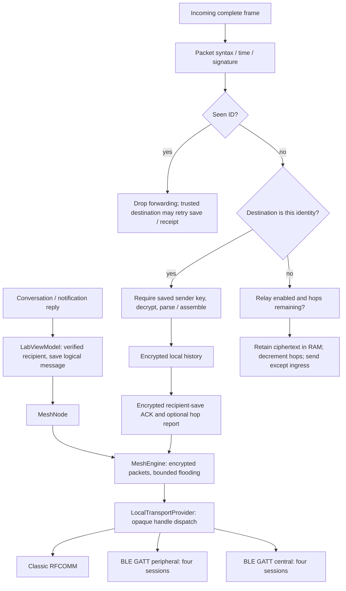
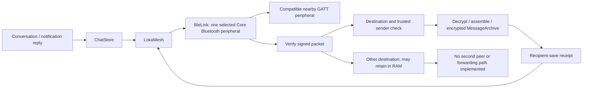

# Current LOKA network architecture

Source audit: October 3, 2026, preview 0.6.17. Existing code was inspected before experiments. The checkout has substantial untracked source; the Git HEAD alone does not identify this implementation. The simulator scaffold is unfinished and has not produced results. The executed receipt queue experiment is recorded in EXP-014. Earlier dated documents are historical snapshots, not current capability attestations.

## Actual Android flow

`MeshNode` installs its own transport listener; raw frames go directly into `MeshEngine`, not the unused ViewModel `onFrame`. Classic socket writes and BLE client writes enqueue asynchronously. A successful `send` return is not a recipient receipt and sometimes not even proof the transport accepted the payload. Handle prefixes select adapters, not the best route to a destination. The composed capability set currently comes from Classic and does not enumerate the complete runtime radio set.

## Actual iOS flow

One selected peer and Boolean link state are **current app constraints**. They are not evidence that iPhone hardware cannot relay. iPhone multi-hop platform feasibility remains **UNKNOWN**; operational multi-link forwarding in this app is **NOT IMPLEMENTED**. There is no iOS peripheral role, so two current iPhone builds cannot form the required direct GATT link with each other.

## Capability and evidence matrix

States: VERIFIED requires a qualifying physical result; IMPLEMENTED is code/software evidence; PARTIAL has material missing behavior; EXPERIMENTAL is isolated prototype/research; NOT IMPLEMENTED has no functioning path; UNKNOWN lacks sufficient evidence. Evidence class is stated separately so software tests cannot be mistaken for hardware proof.

| Capability | State | Source/evidence and limits |
|---|---|---|
| Android Classic discovery and links | IMPLEMENTED | BluetoothTransport; pairing and engineering address approval; automatic reconnect is not implemented for Classic |
| Android BLE discovery and automatic links | IMPLEMENTED | BleClientTransport + BleTransport; service filter and public eight-byte election token; four central + four peripheral app caps, not measured useful concurrency |
| iOS BLE central direct path | IMPLEMENTED | BleLink; service-filtered scan, subscribe, public probe; user-reported repeated reconnect failures are physical failure observations, not passing delivery evidence |
| iOS peripheral / operational relay | NOT IMPLEMENTED | No peripheral manager; LokaMesh incoming relay packets are never sent on another peer |
| iPhone multi-hop platform feasibility | UNKNOWN | No qualifying physical simultaneous-peer/relay test |
| Wi-Fi Aware / Direct / local LAN | NOT IMPLEMENTED | No network adapter, Aware entitlement or compatible data-path negotiation in either app |
| Device identity and saved contact trust | IMPLEMENTED | RSA device key in Keystore/Keychain, SHA-256 fingerprints, saved public keys; account identity/registration separate and absent |
| Authenticated neighbor sessions / handoff | NOT IMPLEMENTED | Public link probe and discovery token do not bind a radio handle to a verified identity |
| Trust independent of connection | IMPLEMENTED | Saved contact keys survive link loss; Android radio approvals/blocked handles are separately persisted; handles are not identity |
| End-to-end encryption/authentication | IMPLEMENTED | LabCrypto/LokaProtocol, real Kotlin–Swift tests; experimental envelope, no independent audit, forward secrecy, ratchet or remote revocation |
| Android ciphertext multi-hop | IMPLEMENTED | MeshEngine/MeshNode integration tests, including a relay with no trusted contacts; physical controlled topology gate remains open |
| Flooding and duplicate suppression | IMPLEMENTED | Seen-ID map, bounded pending map, ingress exclusion; verification happens before duplicate lookup; trusted destination duplicates may decrypt again |
| TTL / hops | IMPLEMENTED | Five-minute lifetime, remaining budget 6 = up to seven links; mutable hops are unsigned and not an authenticated path trace |
| Own outgoing persistence | PARTIAL | Android atomic no-backup outbox; iOS encrypted archive. History and packet enqueue are not a single atomic transaction |
| Durable relay / restart-safe replay | NOT IMPLEMENTED | Relay and seen maps are RAM only; source outbox is not durable relay custody |
| Recipient-save / read receipts | IMPLEMENTED | L1 A/B, sender/recipient binding and history save; background receipt is not a read receipt. H hop estimate is unverified |
| Retry / reconnect replay | IMPLEMENTED | Engine tick sends four eligible packets, >=15 seconds since last packet attempt; link-up replays all pending except ingress, without tick pacing |
| Destination route discovery / scoring | NOT IMPLEMENTED | No destination route table, route request/reply, path quality or route selection |
| Preconnected alternate-path forwarding | IMPLEMENTED | Injected-transport software tests; not automatic discovery or physical recovery proof |
| Android background runtime | PARTIAL | connectedDevice foreground service, START_NOT_STICKY, radio-state receiver; OEM survival/battery/reboot tests pending |
| iOS background runtime | PARTIAL | bluetooth-central restoration, bounded reconnect; process suspension and protected-data availability constrain work |
| Link signal presentation | PARTIAL | RSSI and age on adjacent links; not destination latency, throughput or call admission |
| Network Quality Engine | NOT IMPLEMENTED | No end-to-end sample collector/route-bound workload classification; experimental simulator produces diagnostics only |
| Privacy-safe structured telemetry | PARTIAL | Bounded diagnostic strings, link state and message timestamps; no production counters for bytes/retry/drop reasons; identifiers remain metadata |
| Internet / Cloud / Go / Gateway delivery | NOT IMPLEMENTED | Documentation stubs; no online prerequisite in ordinary local messaging |
| 100+ phone reliability / range / battery | UNKNOWN | No hardware fleet or qualified physical results |

## Bounds, persistence and reconnection

Packet-v0 has canonical UUID, source/destination fingerprints, creation/expiry, mutable remaining hops, sender public key, wrapped AES key, nonce, ciphertext and signature. Frames are <=16,384 bytes; plaintext <=2,048 bytes. Chat text is <=1,400 bytes, photos <=64 KiB and voice <=96 KiB/60 seconds split into separate encrypted envelopes. No priority/replication quota/capability handshake exists. Relays can observe metadata but do not need plaintext.

Android engine: 128 pending packets, 2,048 seen IDs; new entries refused at capacity, cleanup on receive/link-up/tick. Four eligible packets per tick is a packet cap, not a per-neighbor transmission cap. Every selected packet fans out to all connected non-ingress handles. The app ticks every two seconds. Seen records last until expiry; destination ACK discards sender packets but cannot purge relay copies. Relay disable purges foreign pending packets. Queue-full is checked after inserting a seen record, so subsequent copies cannot repair a refused relay enqueue until expiry.

BLE: 19 payload bytes/chunk, 2,048 queued chunks/session, 128 posted complete-frame callbacks, and Android receive budget burst eight then four complete frames/second per peer. Chunk retransmission/write-with-response and indication costs are additional to packet-v0 bytes. Client candidates/cooldowns cap at 32; cooldown 30 seconds; setup 20 seconds, operations 12 seconds, probe window 15 seconds. Scan failures have three delayed retries. Token ordering reduces duplicate Android initiators but is spoofable. No per-origin/global signed-packet work budget or Sybil-resistant admission exists. Classic has no equivalent ingress token budget.

iOS: one selected peer; setup/write/probe deadlines, bounded retries then passive scanning, remembered peer is only a hint. Explicit Off is honored. Foreground resume resets recovery policy; this is not perpetual background execution. Restored subscriptions and stale callbacks are handled in code, with software policy tests. Protected Keychain identity and history keys are unavailable while locked; verified destination ciphertext can enter a bounded locked inbox, but private processing/save receipts wait for unlock.

Sources: Android `core/{MeshNode,MeshEngine,Packet,LabCrypto,ChatContent,LocalLinkPolicy}.kt`, app `{LocalTransportProvider,BluetoothTransport,BleTransport,BleClientTransport,LabViewModel,LocalNotifications,HistoryStore}.kt`; iOS `Core/{LokaMesh,LokaProtocol,ChatContent}.swift`, `Network/{BleLink,BleFraming}.swift`, `Features/{ChatStore,MessageArchive,ContactStore}.swift`; manifests, security reviews and EXP-003/005/007/012. No production routing changes accompany this audit.

## 0.6.18 follow-up

The baseline above predates the targeted [receipt/background improvements](../../experiments/EXP-014-receipt-priority-background.md). Android now uses START_STICKY while local connection is enabled; iOS constructs the restoration runtime during app launch. These are software changes, not evidence of physical background reliability.
