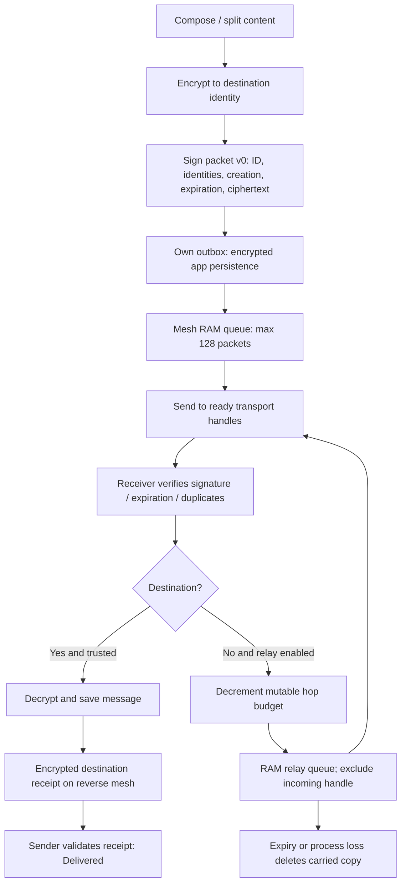

# Current implementation audit

2026-10-03 source inspection. Code presence is not physical qualification.

## Packet lifecycle today



```mermaid
sequenceDiagram
  participant A as Sender
  participant B as Carrier
  participant C as Recipient
  A->>B: Signed ciphertext; original expiry
  Note over B: RAM retention only today
  Note over A,C: No simultaneous end-to-end path required by core forwarding
  B->>C: Later encounter, only before 5-minute expiry
  C->>B: Encrypted destination ACK
  B->>A: Later return opportunity, before ACK expiry
  Note over A: Transport admission alone never means Delivered
```

## Source anchors and boundaries

| Area | Current behavior / gap | Source |
|---|---|---|
| Android routing | Bounded flooding, exact ingress exclusion, 128 pending, 2048 seen, 15-second retries of four candidates | [MeshEngine.kt](../../../android/loka-mesh-lab/core/src/main/kotlin/org/loka/core/MeshEngine.kt) |
| iOS routing | Similar flooding, targeted handles, up to 16 active mesh handles; replay on new links | [LokaMesh.swift](../../../ios/Core/LokaMesh.swift) |
| Envelope | UUID, source/destination key fingerprints, created/expires, sender key, wrapped AES key, nonce, ciphertext, signature | [Packet.kt](../../../android/loka-mesh-lab/core/src/main/kotlin/org/loka/core/Packet.kt), [LokaProtocol.swift](../../../ios/Core/LokaProtocol.swift) |
| Lifetime | Signed creation/expiry; maximum 300000 ms; rejects creation older than five minutes too | Same packet validators |
| E2EE | Experimental RSA-3072 wrapped AES-GCM message key; relays verify but cannot decrypt recipient content. Not a forward-secret session ratchet | Same protocol/crypto files |
| Hop accounting | Mutable budget starts six; destination reports links from remaining budget. Not authenticated route history | Mesh and protocol files |
| Persistence | `queued()` exports own-source packets only; `restore()` refuses foreign source. History/outbox encrypted separately | Both mesh cores; [ChatStore](../../../ios/Features/ChatStore.swift) |
| ACK | Destination receipt is encrypted application content; read receipt distinct. Relays cannot consume receipt as public deletion proof | ChatStore / Android LabViewModel |
| Locked iOS | Foreign `receiveFrame` forwards only when protected data available; inbox fallback covers locally addressed packets | ChatStore `receiveFrame` / `drainInbox` |

Link paths above are relative from this directory; platform sources remain authoritative.

## Radios and discovery

Android `LocalTransportProvider` combines native Classic RFCOMM, BLE peripheral,
BLE central, LAN sockets and Wi-Fi Aware adapters. It dispatches by peer handle;
it is not a measured best-route selector. No production `WifiP2pManager` adapter
was found: UI wording must not imply native Wi-Fi Direct exists merely because
local Wi-Fi or Aware exists. Classic is not the iPhone interoperability path.

iOS has the primary restored BLE central, Apple BLE peripheral and extra centrals,
LAN client and Aware adapter. Primary restoration does not automatically restore
every additional connection. LAN browser/client connectivity needs a shared local
network; it does not form a router-free network. Wi-Fi Aware platform support and
the isolated bootstrap probe do not establish production Android/iPhone pairing.
See [prior Aware evidence](../wifi-aware/12-architecture-recommendation.md).

BLE uses the LOKA GATT service, writes/indications and bounded frame reassembly.
Small chunks, write/indication acknowledgments, application retries and radio queue
limits all contribute to latency. Public readiness probes are not authenticated
destination delivery. Multiple radios to one physical peer can represent multiple
handles: ingress exclusion alone does not prevent a duplicate via another radio.

There is no implemented local-message Internet P2P fallback in this audited path.
Backend, Go and Gateway are separate. Wi-Fi radio state must not be gated on
Internet validation. [Engineering rule](../../WIFI-RADIO-VS-INTERNET.md).

## Identity, storage, congestion and lifecycle

Saved contacts bind public keys and trust; nearby profile presentation does not
prove a route. Packet routing exposes stable endpoint fingerprints, timing and
size. Anonymous ciphertext carriage is different from anonymous metadata.

Source history persistence is not relay persistence. Queues reject at count limits;
there is no durable foreign journal, peer inventory, transactional copy budget,
relay-readable authenticated tombstone, cancellation propagation, encounter
predictor or resource advertisement. Retry attempts are tracked per packet, not a
complete per-peer congestion controller. Receipt priority exists on local send;
ordinary relays cannot inspect encrypted receipt type to preserve that priority.

Android uses a connected-device foreground service and START_STICKY; that is not
proof of survival across OEM restrictions or force-stop. iOS callbacks and finite
runtime cannot be replaced by a perpetual timer. Keeping the setting “on” means
user intent, not that the OS is executing relay work. The locked-data gate is an
additional application constraint to measure separately from OS suspension.

## Consequences

1. Hours-long carry is incompatible with today's wire validation, even with disk storage.
2. A five-minute packet can still be lost on carrier process restart before expiry.
3. Delivery and receipt can fail independently; “waiting” does not prove which hop failed.
4. Hop display is a mutable-budget estimate, not proof that the kitchen iPad carried a packet.
5. No current evidence establishes reliable screen-off multi-hop or automatic optimal-radio selection.

Next experiments must preserve this baseline, correlate a random message test ID
across admission/forward/destination/receipt events, and avoid logging plaintext,
keys, names or full permanent identities.
